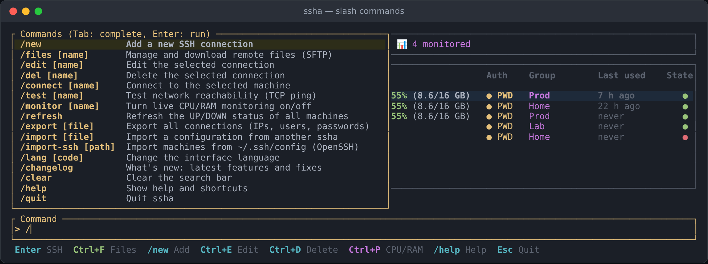

# ssha

[](https://github.com/gigi74168/SSHA/actions/workflows/ci.yml)
[](https://github.com/gigi74168/SSHA/releases/latest)
[](#installation-once-available-everywhere)
[](#languages)
[](LICENSE)
[](https://www.rust-lang.org/)

**`ssha`** is a **100% CLI SSH & SFTP connection manager** written in Rust, for **Windows 10 / 11**, **Linux** (Debian, Ubuntu, Arch, Fedora, etc.) and **macOS** (Apple Silicon & Intel).

Save your machines once (e.g. `192.168.1.192` + password or SSH key) or import your `~/.ssh/config`, then reconnect instantly without typing your password again — **zero external dependency** (no `sshpass` needed, the SSH & SFTP client is 100% native Rust). Watch the **live CPU / RAM usage** of your servers right from the list.

---

## Screenshots

> The screenshots below were taken with the French interface of an earlier version; the interface is now available in 6 languages.

### Saved connections list (`ssha`)


### Quick commands with autocompletion (`/new`, `/files`, `/export`, `/import-ssh`...)


### Adding a new machine (`/new`)


---

## Features

- **100% CLI interactive interface (`ssha`)**:
  - Live **`UP` / `DOWN`** status next to each IP + green / red **`●`** indicator on the far right (non-blocking parallel check, refreshed every 15 s or with `Ctrl+R` / `F5` / `/refresh`)
  - **Live CPU / RAM monitoring** next to each machine: `CPU 34% · RAM 71% (2.8/4 GB)`, refreshed every 2 s, green / yellow / red depending on load — see [Live CPU / RAM monitoring](#live-cpu--ram-monitoring)
  - **Machine name autocompletion** above the input bar with **`Tab`** completion and greyed inline preview
  - Built-in slash commands with autocompletion (`Tab`): `/new`, `/files`, `/edit`, `/del`, `/connect`, `/test`, `/monitor`, `/refresh`, `/export`, `/import`, `/import-ssh`, `/lang`, `/changelog`, `/help`, `/quit`
  - Keyboard shortcuts (`↑`/`↓`, `Enter`, `Tab`, `Ctrl+F`, `Ctrl+N`, `Ctrl+E`, `Ctrl+D`, `Ctrl+T`, `Ctrl+P`, `Ctrl+R`, `Esc`)
- **6 interface languages**: English, Français, Русский, Українська, Español, Italiano — chosen on first start (pre-selected on your system language) — see [Languages](#languages)
- **Remote file manager (built-in SFTP)**:
  - **Automatic SFTP installation** on remote Linux machines when the SFTP subsystem is missing or disabled (`apt`, `pacman`, `dnf`, `yum`, `apk`, `zypper`, `opkg` + `internal-sftp`)
  - **Native Windows, macOS & Linux dialogs** to choose files or folders to upload (`Ctrl+U` / `/upload`) and where to save downloads (`Ctrl+D` → `Ctrl+P` / `F3`)
  - **Recursive** transfers of files and whole folders in both directions (`ssha get`, `ssha put`), scrollable text preview (`Enter`), folder creation, renaming and recursive deletion
- **OpenSSH import (`~/.ssh/config`) & advanced SSH options**:
  - One-command import of all your existing machines (`ssha import-ssh` or `/import-ssh`)
  - Native support for **ProxyJump / Bastion** (`-J`), **local port forwarding** (`-L local_port:remote_host:remote_port`) and **multiple `IdentityFile`**
- **Full configuration import / export**:
  - Move all your connections (IPs, ports, users, passwords, keys, groups, notes) to another PC with `ssha export` / `ssha import` (or `/export` / `/import`)
- **AES-256-GCM encryption (automatic or optional master password)**:
  - **Automatic mode by default** (no master password to remember): key protected by **Windows DPAPI** on Windows 10/11 and strict `0600` permissions on Linux/macOS
  - **Optional master password mode** (`ssha security enable-master-password`): **Argon2id + AES-256-GCM** derivation for a 100% portable `vault.enc`
- **Built-in automatic updates with release notes**:
  - Detects new GitHub releases at startup and offers to update right in the terminal (`[Y/n]`), or on demand with `ssha update` (`SSHA_NO_UPDATE_CHECK=1` to disable)
  - The update prompt lists the **new features ✨ and fixes 🐛** of every version you are about to get, **in your language**
  - A **"What's new"** screen is shown once on the first launch after an update (see it again with `ssha changelog` or `/changelog`)

---

## Installation (once, available everywhere)

### Windows 10 & 11 (PowerShell)

```powershell
irm https://raw.githubusercontent.com/gigi74168/SSHA/main/installers/install.ps1 | iex
```
*(Installs `ssha.exe` into `%LOCALAPPDATA%\Programs\ssha` and adds it to the user `PATH` without admin rights. A double-click launcher `installers\install.bat` is also available.)*

### Linux & macOS (Debian, Ubuntu, Arch, Fedora, macOS Apple Silicon & Intel)

```bash
curl -fsSL https://raw.githubusercontent.com/gigi74168/SSHA/main/installers/install.sh | bash
```

### With Cargo (Windows, Linux & macOS)

```bash
cargo install --path .
```

---

## Usage

### 1. Interactive interface
```bash
ssha
```

### 2. Direct commands from the terminal
```bash
ssha my-pc                                     # Direct SSH connection to "my-pc"
ssha files my-pc                               # Open the remote file explorer (SFTP)
ssha get my-pc /home/me/report.pdf             # Download a file/folder into Downloads
ssha get my-pc /home/me/my-folder ./dest       # Download a folder recursively wherever you want
ssha put my-pc                                 # Open the native dialog to choose a file
ssha put my-pc --dir                           # Open the dialog to choose a folder to upload
ssha put my-pc ./my-folder /home/me/           # Upload a local file/folder directly
ssha new --monitor                             # Add a machine with live CPU/RAM monitoring
ssha new -J bastion -L 8080:127.0.0.1:80       # Add a machine with ProxyJump and a local tunnel
ssha import-ssh                                # Import automatically from ~/.ssh/config
ssha export                                    # Export all connections (IPs, users, passwords) to JSON
ssha import                                    # Import a configuration exported by another ssha
ssha security status                           # Show the encryption mode (automatic or master password)
ssha security enable-master-password           # Enable the master password mode (Argon2id)
ssha list                                      # List connections with live UP/DOWN status
ssha test my-pc                                # Test TCP reachability + latency
ssha rm my-pc                                  # Delete a connection
ssha update                                    # Check for and install the latest version
ssha changelog                                 # Show the new features and fixes of recent versions
ssha lang fr                                   # Change the interface language
ssha info                                      # Show where the encrypted vault is stored
```

---

## Live CPU / RAM monitoring

```
  Name        Address                     CPU / RAM                         Auth   State
▸ prod-web    deploy@10.0.0.12  UP        CPU  34% · RAM  71% (2.8/4 GB)    ● KEY    ●
  nas         admin@192.168.1.5  UP       CPU   8% · RAM  42% (3.4/8 GB)    ● PWD    ●
  old-pc      root@192.168.1.9  DOWN      —                                 ● PWD    ●
```

- Enabled **per machine**: `Monitor CPU/RAM` checkbox in the `/new` / `/edit` form, **`Ctrl+P`** or **`/monitor [name]`** in the interface, or `ssha new --monitor`.
- `ssha` keeps a quiet background SSH session to each monitored machine (using the credentials of your vault) and reads `/proc/stat` and `/proc/meminfo` every 2 seconds. Nothing is installed on the server.
- Works with **Linux** servers; other systems show `n/a`.
- Background connections never ask anything: if a server host key changed, the machine shows **`⚠ key`** until you connect to it once manually to review the new fingerprint.
- Authentication or connection errors show `✗` in the column, with the detailed message in the status bar when the machine is selected.
- Disable it everywhere with `SSHA_NO_MONITOR=1`.

---

## Languages

The interface, the error messages, `ssha --help` and the release notes are available in:

| Code | Language |
|---|---|
| `en` | English |
| `fr` | Français |
| `ru` | Русский |
| `uk` | Українська |
| `es` | Español |
| `it` | Italiano |

- On **first start**, `ssha` asks for your language, pre-selected on your system language.
- Change it any time with **`/lang`** (interactive picker), **`ssha lang <code>`** or the **`SSHA_LANG`** environment variable (which takes priority).
- The choice is stored in `settings.json`, next to the vault.
- The changelog is available in every language: [English](CHANGELOG.md) · [Français](CHANGELOG.fr.md) · [Русский](CHANGELOG.ru.md) · [Українська](CHANGELOG.uk.md) · [Español](CHANGELOG.es.md) · [Italiano](CHANGELOG.it.md)

---

## File locations

| System | Encrypted vault (`vault.enc`) and `settings.json` |
|---|---|
| **Windows 10/11** | `%APPDATA%\ssha\config\` |
| **Linux** | `~/.config/ssha/` |
| **macOS** | `~/Library/Application Support/ssha/` |

*(Can be changed with the `SSHA_CONFIG_DIR` environment variable.)*

### Environment variables

| Variable | Effect |
|---|---|
| `SSHA_CONFIG_DIR` | Custom configuration folder |
| `SSHA_LANG` | Force the interface language (`en`, `fr`, `ru`, `uk`, `es`, `it`) |
| `SSHA_NO_UPDATE_CHECK` | Disable the update check at startup |
| `SSHA_NO_MONITOR` | Disable live CPU/RAM monitoring |

---

## Documentation & contributing

- Version history: [CHANGELOG.md](CHANGELOG.md)
- Contributing guide: [CONTRIBUTING.md](CONTRIBUTING.md)
- License: [MIT](LICENSE)
