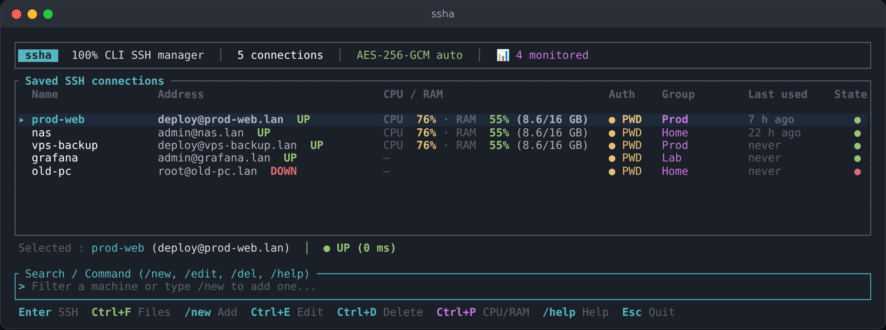

# ssha

**`ssha`** est un gestionnaire de connexions SSH **100 % CLI** écrit en Rust, compatible **Windows 10 / 11** et **Linux** (Debian, Ubuntu, Arch, Fedora, etc.).

Enregistre tes machines une seule fois (ex. `192.168.1.192` + mot de passe ou clé SSH), puis reconnecte-toi instantanément sans retaper ton mot de passe — sans aucune dépendance externe (`sshpass` n'est pas nécessaire, le client SSH est 100 % natif en Rust).

---

## Captures d'écran

### Liste des connexions enregistrées (`ssha`)


### Commandes rapides avec autocomplétion (`/new`, `/edit`, `/del`, `/test`...)


### Ajout d'une nouvelle machine (`/new`)


---

## Fonctionnalités

- **Interface 100 % CLI interactive (`ssha`)** :
  - Liste filtrable en temps réel (tape un nom, une IP ou un groupe)
  - Commandes slash intégrées avec autocomplétion (`Tab`) : `/new`, `/files`, `/edit`, `/del`, `/connect`, `/test`, `/help`, `/quit`
  - Raccourcis clavier rapides (`↑`/`↓`, `Entrée`, `Ctrl+F`, `Ctrl+N`, `Ctrl+E`, `Ctrl+D`, `Ctrl+T`, `Esc`)
- **Gestionnaire de fichiers à distance (SFTP intégré)** :
  - Parcours des dossiers distants, filtrage live, fichiers cachés (`Ctrl+H`) et aperçu rapide des fichiers texte (`Entrée`)
  - **Téléchargement** de fichiers ou dossiers complets (récursif) vers ton PC (`Ctrl+D` ou `/download` ou `ssha get`)
  - **Envoi** de fichiers ou dossiers locaux vers le PC distant (`Ctrl+U` ou `/upload` ou `ssha put`)
  - **Création de dossier** (`Ctrl+N` / `/mkdir`), **renommage** (`Ctrl+E` / `/rename`), **suppression** récursive sécurisée (`Ctrl+X` / `/del`)
- **Connexion directe** : `ssha mon-pc` te connecte sans même ouvrir le menu
- **Client SSH & SFTP natif multiplateforme** (`russh` + `russh-sftp`) :
  - Authentification par **mot de passe** (incluant `keyboard-interactive` / PAM) ou **clé privée SSH** (Ed25519, RSA, ECDSA + passphrase optionnelle)
  - PTY interactif complet (couleurs, `vim`, `nano`, `htop`, `tmux`, redimensionnement automatique de la fenêtre, AltGr sur claviers AZERTY Windows)
  - Vérification des empreintes serveurs (TOFU) avec alerte en cas de changement suspect
- **Chiffrement automatique transparent** :
  - Tes connexions et mots de passe sont chiffrés dans `vault.enc` en **AES-256-GCM**
  - Clé générée et gérée automatiquement par le logiciel (**aucun mot de passe maître à gérer**) :
    - **Windows 10/11** : clé protégée par **Windows DPAPI** (liée à ta session utilisateur Windows)
    - **Linux** : clé locale protégée en permissions strictes `0600` dans `~/.config/ssha/`

---

## Installation (une seule fois, accessible partout)

### Windows 10 & 11 (PowerShell)

**Depuis GitHub Releases (sans avoir besoin de Rust) :**
```powershell
irm https://raw.githubusercontent.com/gigi74168/SSHA/main/installers/install.ps1 | iex
```

**Ou depuis ce dépôt cloné :**
Double-clique sur `installers\install.bat` ou lance dans PowerShell :
```powershell
.\installers\install.ps1
```
L'installateur copie `ssha.exe` dans `%LOCALAPPDATA%\Programs\ssha` et l'ajoute automatiquement à ton `PATH` utilisateur (aucun droit administrateur requis).

### Linux (Debian, Ubuntu, Arch, Fedora, etc.)

**Depuis GitHub Releases :**
```bash
curl -fsSL https://raw.githubusercontent.com/gigi74168/SSHA/main/installers/install.sh | bash
```

**Ou depuis ce dépôt cloné :**
```bash
chmod +x installers/install.sh
./installers/install.sh
```

**Ou directement avec Cargo (Linux & Windows) :**
```bash
cargo install --path .
```

---

## Utilisation

### 1. Lancer l'interface interactive
```bash
ssha
```

Dans l'interface :
- Tape **`/new`** (ou appuie sur `Ctrl+N`) pour ajouter une nouvelle machine (ex: nom `mon-pc`, IP `192.168.1.192`, utilisateur, mot de passe SSH).
- Utilise **`↑` / `↓`** (ou tape quelques lettres pour filtrer) puis appuie sur **`Entrée`** pour ouvrir le terminal SSH, ou **`Ctrl+F`** (ou `/files`) pour ouvrir le **gestionnaire de fichiers distant**.
- Dans le gestionnaire de fichiers : `Entrée` ouvre un dossier ou affiche un aperçu texte, `Ctrl+D` (`/download`) télécharge sur ton PC, `Ctrl+U` (`/upload`) envoie un fichier local, `Ctrl+N` (`/mkdir`) crée un dossier, `Ctrl+E` (`/rename`) renomme, `Ctrl+X` (`/del`) supprime.

### 2. Commandes directes depuis le terminal
```bash
ssha mon-pc                                    # Connexion SSH directe à "mon-pc"
ssha files mon-pc                              # Ouvrir l'explorateur de fichiers distant (SFTP)
ssha get mon-pc /home/gigi/rapport.pdf         # Télécharger un fichier/dossier dans Téléchargements
ssha get mon-pc /var/log/app.log ./app.log     # Télécharger vers un chemin local précis
ssha put mon-pc ./mon-fichier.txt /tmp/        # Envoyer un fichier/dossier local vers le PC distant
ssha new                                       # Assistant d'ajout en ligne de commande
ssha list                                      # Lister toutes les connexions enregistrées
ssha test mon-pc                               # Tester la joignabilité TCP + latence
ssha rm mon-pc                                 # Supprimer une connexion
ssha info                                      # Afficher l'emplacement du coffre-fort chiffré
```

---

## Emplacement des fichiers

| Système | Coffre-fort chiffré (`vault.enc`) |
|---|---|
| **Windows 10/11** | `%APPDATA%\ssha\config\` |
| **Linux** | `~/.config/ssha/` |

*(Tu peux aussi personnaliser le dossier via la variable d'environnement `SSHA_CONFIG_DIR`.)*

---

## Désinstallation

- **Windows** : `.\installers\uninstall.ps1` (ajouter `-Purge` pour supprimer aussi le coffre-fort)
- **Linux** : `./installers/uninstall.sh` (ajouter `--purge` pour supprimer aussi le coffre-fort)
