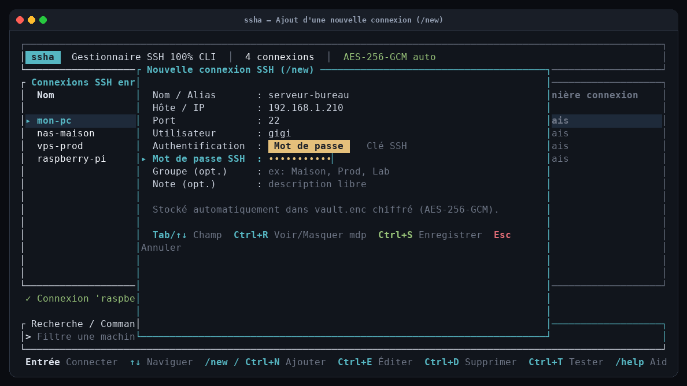

# ssha

[](https://github.com/gigi74168/SSHA/actions/workflows/ci.yml)
[](https://github.com/gigi74168/SSHA/releases/latest)
[](#installation-une-seule-fois-accessible-partout)
[](LICENSE)
[](https://www.rust-lang.org/)

**`ssha`** est un gestionnaire de connexions **SSH & SFTP 100 % CLI** écrit en Rust, compatible **Windows 10 / 11**, **Linux** (Debian, Ubuntu, Arch, Fedora, etc.) et **macOS** (Apple Silicon & Intel).

Enregistre tes machines une seule fois (ex. `192.168.1.192` + mot de passe ou clé SSH) ou importe directement ton `~/.ssh/config`, puis reconnecte-toi instantanément sans retaper ton mot de passe — **zéro dépendance externe** (`sshpass` n'est pas nécessaire, le client SSH & SFTP est 100 % natif en Rust).

---

## Captures d'écran

### Liste des connexions enregistrées (`ssha`)


### Commandes rapides avec autocomplétion (`/new`, `/files`, `/export`, `/import-ssh`...)


### Ajout d'une nouvelle machine (`/new`)


---

## Fonctionnalités

- **Interface 100 % CLI interactive (`ssha`)** :
  - Statut en direct **`UP` / `DOWN`** à côté de chaque IP + voyant **`●` vert / rouge** tout à droite (vérification parallèle non bloquante, actualisée automatiquement toutes les 15 s ou via `Ctrl+R` / `F5` / `/refresh`)
  - **Autocomplétion des noms de machines** au-dessus de la barre de texte avec complétion **`Tab`** et aperçu grisé en ligne
  - Commandes slash intégrées avec autocomplétion (`Tab`) : `/new`, `/files`, `/edit`, `/del`, `/connect`, `/test`, `/refresh`, `/export`, `/import`, `/import-ssh`, `/help`, `/quit`
  - Raccourcis clavier rapides (`↑`/`↓`, `Entrée`, `Tab`, `Ctrl+F`, `Ctrl+N`, `Ctrl+E`, `Ctrl+D`, `Ctrl+T`, `Ctrl+R`, `Esc`)
- **Gestionnaire de fichiers à distance (SFTP intégré)** :
  - **Installation automatique de SFTP** sur les machines Linux distantes si le sous-système SFTP n'est pas encore installé ou activé (`apt`, `pacman`, `dnf`, `yum`, `apk`, `zypper`, `opkg` + `internal-sftp`)
  - **Fenêtres natives Windows, macOS & Linux** pour choisir des fichiers ou dossiers à envoyer (`Ctrl+U` / `/upload`) et choisir où enregistrer les téléchargements (`Ctrl+D` → `Ctrl+P` / `F3`)
  - Transferts **récursifs** de fichiers et dossiers complets dans les deux sens (`ssha get`, `ssha put`), aperçu texte scrollable (`Entrée`), création de dossier, renommage et suppression récursive
- **Import OpenSSH (`~/.ssh/config`) & Options SSH avancées** :
  - Import en une commande de toutes tes machines existantes (`ssha import-ssh` ou `/import-ssh`)
  - Support natif de **ProxyJump / Bastion** (`-J`), **Local Port Forwarding** (`-L local_port:remote_host:remote_port`), et **multiples `IdentityFile`**
- **Import / Export complet de la configuration** :
  - Transfère toutes tes connexions (IP, ports, utilisateurs, mots de passe, clés, groupes, notes) vers un autre PC via `ssha export` / `ssha import` (ou `/export` / `/import`)
- **Chiffrement AES-256-GCM (automatique ou mot de passe maître optionnel)** :
  - **Mode automatique par défaut** (aucun mot de passe maître à retenir) : clé protégée par **Windows DPAPI** sur Windows 10/11 et permissions strictes `0600` sur Linux/macOS
  - **Mode mot de passe maître optionnel** (`ssha security enable-master-password`) : dérivation **Argon2id + AES-256-GCM** pour un `vault.enc` 100 % portable entre machines
- **Mises à jour automatiques intégrées** :
  - Détecte automatiquement les nouvelles releases GitHub au lancement et propose de mettre à jour directement dans le terminal (`[O/n]`), ou à la demande via `ssha update` (`SSHA_NO_UPDATE_CHECK=1` pour désactiver)

---

## Installation (une seule fois, accessible partout)

### Windows 10 & 11 (PowerShell)

```powershell
irm https://raw.githubusercontent.com/gigi74168/SSHA/main/installers/install.ps1 | iex
```
*(Installe `ssha.exe` dans `%LOCALAPPDATA%\Programs\ssha` et l'ajoute au `PATH` utilisateur sans droits admin. Un lanceur double-clic `installers\install.bat` est aussi disponible.)*

### Linux & macOS (Debian, Ubuntu, Arch, Fedora, macOS Apple Silicon & Intel)

```bash
curl -fsSL https://raw.githubusercontent.com/gigi74168/SSHA/main/installers/install.sh | bash
```

### Via Cargo (Windows, Linux & macOS)

```bash
cargo install --path .
```

---

## Utilisation

### 1. Interface interactive
```bash
ssha
```

### 2. Commandes directes depuis le terminal
```bash
ssha mon-pc                                    # Connexion SSH directe à "mon-pc"
ssha files mon-pc                              # Ouvrir l'explorateur de fichiers distant (SFTP)
ssha get mon-pc /home/gigi/rapport.pdf         # Télécharger un fichier/dossier dans Téléchargements
ssha get mon-pc /home/gigi/mon-dossier ./dest  # Télécharger un dossier récursivement où tu veux
ssha put mon-pc                                # Ouvrir la fenêtre Windows/macOS/Linux pour choisir un fichier
ssha put mon-pc --dir                          # Ouvrir la fenêtre pour choisir un dossier à envoyer
ssha put mon-pc ./mon-dossier /home/gigi/      # Envoyer un fichier/dossier local directement
ssha import-ssh                                # Importer automatiquement depuis ~/.ssh/config
ssha export                                    # Exporter toutes les connexions (IP, users, mdp) en JSON
ssha import                                    # Importer une config exportée depuis un autre ssha
ssha security status                           # Voir le mode de chiffrement (auto ou mot de passe maître)
ssha security enable-master-password           # Activer le mode mot de passe maître (Argon2id)
ssha new -J bastion -L 8080:127.0.0.1:80       # Ajouter une machine avec ProxyJump et tunnel local
ssha list                                      # Lister les connexions avec statut UP/DOWN live
ssha test mon-pc                               # Tester la joignabilité TCP + latence
ssha rm mon-pc                                 # Supprimer une connexion
ssha update                                    # Vérifier et installer la dernière version
ssha info                                      # Afficher l'emplacement du coffre-fort chiffré
```

---

## Emplacement des fichiers

| Système | Coffre-fort chiffré (`vault.enc`) |
|---|---|
| **Windows 10/11** | `%APPDATA%\ssha\config\` |
| **Linux** | `~/.config/ssha/` |
| **macOS** | `~/Library/Application Support/ssha/` |

*(Personnalisable via la variable d'environnement `SSHA_CONFIG_DIR`.)*

---

## Documentation & Contribution

- Historique des versions : [CHANGELOG.md](CHANGELOG.md)
- Guide de contribution : [CONTRIBUTING.md](CONTRIBUTING.md)
- Licence : [MIT](LICENSE)
